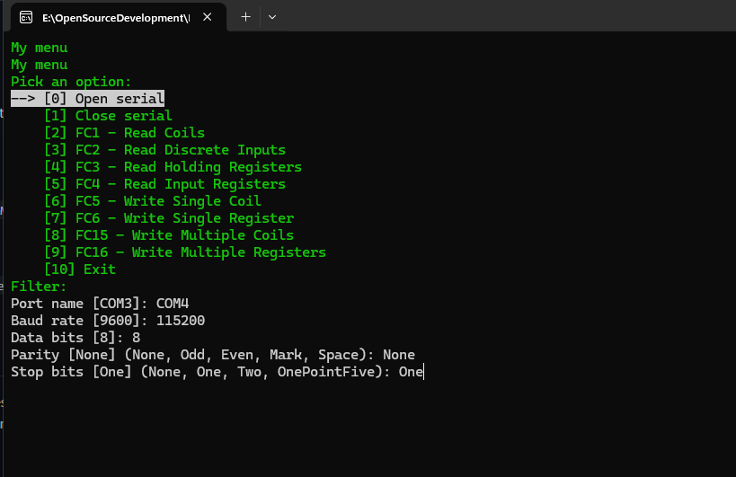

# Modbuska

[](https://github.com/Ledrunning/Modbuska/actions/workflows/build.yml)
[](LICENSE)
[](https://dotnet.microsoft.com)

*Pronounced "mod-BAS-ka" (Модбаска).*

A small, dependency-light **Modbus RTU master** library for .NET.
Built for quick device testing and prototyping: open a serial port, read or write registers, check the result.

- Synchronous API with result objects instead of exceptions for protocol and I/O errors
- Modbus RTU over `System.IO.Ports` (RS-232 / USB-UART / USB-RS485 adapters)
- Strict response validation: CRC, slave address, function code, byte count, write echo
- Verified on real hardware (ESP8266 slave, test firmware included)

> **Scope:** master/client side only, RTU only (no Modbus TCP, no slave/server).
> Modbus RTU has no authentication or encryption. Do not rely on it for security.

## Features

- DI registration via `AddModbus()`
- Optional structured logging with hex TX/RX frame traces (see [Logging](#logging))
- Supported function codes:
  - FC1 - Read Coils
  - FC2 - Read Discrete Inputs
  - FC3 - Read Holding Registers
  - FC4 - Read Input Registers
  - FC5 - Write Single Coil
  - FC6 - Write Single Register
  - FC15 - Write Multiple Coils
  - FC16 - Write Multiple Registers
- Example console application and ESP8266 test firmware included in the repository

## Requirements

- .NET 10
- A serial port (physical, USB adapter, or virtual)

## Installation

Clone the repository and reference the project:

```bash
git clone https://github.com/Ledrunning/Modbuska.git
dotnet add <your-project> reference Modbuska/src/Modbuska.ModbusManager/Modbuska.ModbusManager.csproj
```

## Quick start

`ModbusMessage` is abstract, so declare a tiny request type once in your project:

```csharp
using Modbuska.ModbusManager.Model;

public sealed class RequestMessage : ModbusMessage { }
```

Then register the services, open the port and send a request:

```csharp
using Microsoft.Extensions.DependencyInjection;
using Modbuska.ModbusManager.Extension;
using Modbuska.ModbusManager.Model;
using Modbuska.ModbusManager.Service;

var services = new ServiceCollection();
services.AddModbus();

using var provider = services.BuildServiceProvider();
var serial = provider.GetRequiredService<SerialConnectionService>();
var modbus = provider.GetRequiredService<ModbusRtuService>();

var open = serial.Open(new SerialPortSettings
{
    PortName = "COM3",          // "/dev/ttyUSB0" on Linux
    BaudRate = 115200,
    DataBits = 8,
    Parity = System.IO.Ports.Parity.None,
    StopBits = System.IO.Ports.StopBits.One,
    ReadTimeout = 500,          // ms, default 500
    WriteTimeout = 100          // ms, default 100
});

if (!open.Success)
{
    Console.WriteLine(open.ErrorMessage);
    return;
}

// Read 4 holding registers starting at address 0 from slave 1
var request = new RequestMessage { Address = 1, Start = 0, Register = 4 };
var (result, registers) = modbus.SendFc3(request);

if (result.Success)
    Console.WriteLine(string.Join(", ", registers));
else
    Console.WriteLine($"Error: {result.ErrorMessage}");
```

Always check `result.Success` before using the returned data. On failure the data is a default value.

In `RequestMessage`, `Start` is the first address and `Register` is the **number** of registers or coils.

### Writing

```csharp
// FC6: write a single holding register (slave 1, address 0, value 555)
var (writeResult, echoed) = modbus.SendFc6(
    new RequestMessage { Address = 1, Start = 0, Register = 1 }, 555);

// FC16: write multiple holding registers
var fc16 = modbus.SendFc16(
    new RequestMessage { Address = 1, Start = 0, Register = 3 },
    [10, 20, 30]);

// FC5: write a single coil
var (coilResult, coilState) = modbus.SendFc5(
    new RequestMessage { Address = 1, Start = 0, Register = 1 }, true);
```

## Behavior and validation

- **Request limits** follow the Modbus specification and are checked before anything is sent:
  - reads: up to 2000 coils/inputs (FC1/FC2), up to 125 registers (FC3/FC4)
  - writes: up to 1968 coils (FC15), up to 123 registers (FC16)
  - count must be greater than 0
- **Slave address** must be 1-247. Address `0` is broadcast:
  - writes are sent without waiting for a response and return success with default data (there is no confirmation)
  - reads with address `0` are rejected
- **Responses** are validated for CRC, slave address, function code, byte count and (for writes) the echoed address and value or count. Modbus exception responses are returned as failed results.
- **Thread safety:** each request/response transaction is serialized with a lock, so concurrent calls on the same port will not mix frames. Calls are blocking.
- **Timeouts** are reported as failed results, not thrown.
- Registers are `ushort` (unsigned 16-bit), as defined by the Modbus specification.

## Hardware test with ESP8266 (NodeMCU V3 board)

The repository includes a demo ESP8266 slave firmware in `src/FirmwareSlave/ModbuskaSlaveTester`, built with
[PlatformIO](https://platformio.org/) on top of the
[modbus-esp8266](https://github.com/emelianov/modbus-esp8266) library (check its license for your use). Together with
the `Modbuska.Example` console app, it lets you verify everything on real hardware.

**What the firmware does:** slave ID 1, 16 coils / discrete inputs / input registers / holding registers.
Coils start as `false`, discrete inputs alternate `true/false`, input registers are `i * 100`, holding registers are
`i * 10`. The built-in LED turns on when coil 0 is `1` **or** holding register 0 is `555`.

### Preparation

1. Build and flash the firmware with PlatformIO (`pio run -t upload` from the firmware project folder).
2. Connect the board to your computer over USB.
3. Run `Modbuska.Example` and choose **Open serial** with:
   - Port name: your port (e.g. `COM3` or `/dev/ttyUSB0`)
   - Baud rate: `115200`, Data bits: `8`, Parity: `None`, Stop bits: `One`



### Test scenarios

Run the read checks (FC1-FC4) first on a freshly reset board, because the write checks change its state.
For every function use slave address `1`.

| Function | Console input | Expected result |
|----------|---------------|-----------------|
| **FC1** Read Coils | start `0`, count `8` | `Coils: False, False, False, False, False, False, False, False` |
| **FC2** Read Discrete Inputs | start `0`, count `8` | `Inputs: True, False, True, False, True, False, True, False` |
| **FC3** Read Holding Registers | start `0`, count `4` | `Holding registers: 0, 10, 20, 30` |
| **FC4** Read Input Registers | start `0`, count `4` | `Input registers: 0, 100, 200, 300` |
| **FC5** Write Single Coil | address `0`, value `1` | `Returned coil state: True` and the **LED turns on**. Write `0` and the LED turns off. |
| **FC6** Write Single Register | address `0`, value `555` | `Returned register value: 555` and the **LED turns on**. Write any other value (e.g. `10`) and the LED turns off. |
| **FC15** Write Multiple Coils | start `0`, count `4`, values `1,0,1,1` | `Written coils: True, False, True, True`. Verify with FC1 (start `0`, count `4`). |
| **FC16** Write Multiple Registers | start `0`, count `3`, values `100,200,300` | `Written registers: 100, 200, 300`. Verify with FC3 (start `0`, count `3`). |

> Note: the LED on ESP8266 boards is active-low. The firmware handles this, so "on" in the table means the LED is
> physically lit.

## Example project

`Modbuska.Example` is a console app with a menu-based execution of all implemented Modbus functions through DI.
It enables the console logger at `Trace` level, so you can watch every frame on the wire while you test.

## Logging

The library depends only on `Microsoft.Extensions.Logging.Abstractions` and does **not** configure any logging
provider itself: `AddModbus()` intentionally does not call `AddLogging()`. The host application chooses and
configures the providers (console, Serilog, etc.).

Both `ModbusRtuService` and `SerialConnectionService` accept an optional `ILogger<T>` in their constructors. When no
logger is provided, `NullLogger<T>.Instance` is used, so logging is completely optional and never throws.

When a logger is wired up:

- `Trace`: every TX/RX frame as hex
- `Debug`: completed operations (slave, function, item count); validation failures (invalid address, count == 0,
  limit exceeded)
- `Warning`: transaction failures (serial port closed, rejected broadcast read, timeout, invalid CRC, Modbus
  exception response with its code, write echo mismatch, response validation errors). The exception is passed along,
  so its type and stack trace are preserved.
- `Error`: serial port open/close failures
- `Information`: serial port opened/closed (with port settings)

All log messages use named template parameters in PascalCase (`SlaveId`, `Function`, `Frame`, `PortName`, ...), so the
values are available as structured fields for Serilog / Elasticsearch / Kibana.

### Enabling frame traces (console provider)

```csharp
using Microsoft.Extensions.DependencyInjection;
using Microsoft.Extensions.Logging;
using Modbuska.ModbusManager.Extension;

var services = new ServiceCollection();
services.AddLogging(builder => builder
    .AddConsole()
    .SetMinimumLevel(LogLevel.Trace));
services.AddModbus();
```

With `Trace` enabled you will see output like:

```
TX SlaveId=1 Function=ReadHoldingRegisters Frame=01 03 00 00 00 02 C4 0B
RX SlaveId=1 Function=ReadHoldingRegisters Frame=01 03 04 00 0A 00 0B 9B F6
```

In a real application you usually want `Trace` for Modbuska only and a quieter level for everything else:

```csharp
services.AddLogging(builder => builder
    .AddConsole()
    .SetMinimumLevel(LogLevel.Warning)
    .AddFilter("Modbuska", LogLevel.Trace));
```

### Serilog example

Packages: `Serilog.Extensions.Logging` and `Serilog.Sinks.Console` (add a file or Elasticsearch sink the same way).

```csharp
using Microsoft.Extensions.DependencyInjection;
using Microsoft.Extensions.Logging;
using Modbuska.ModbusManager.Extension;
using Serilog;
using Serilog.Events;

Log.Logger = new LoggerConfiguration()
    .MinimumLevel.Information()
    .MinimumLevel.Override("Modbuska", LogEventLevel.Verbose) // Serilog Verbose == Microsoft.Extensions.Logging Trace
    .WriteTo.Console()
    .CreateLogger();

var services = new ServiceCollection();
services.AddLogging(builder => builder.AddSerilog(dispose: true));
services.AddModbus();
```

> **Warning:** `Trace` logs every frame on the wire, which includes device data such as slave addresses, function
> codes, register values and CRC bytes. It also produces a high volume of records. Do not leave `Trace` enabled on
> production systems with frequent traffic; keep the level at `Warning` or higher.

## Building and testing

```bash
dotnet build
dotnet test
```

Unit tests use a fake serial connection, so no hardware is needed.

## Limitations and roadmap

Current limitations:

- synchronous (blocking) API only
- RTU master only
- no RS-485 direction control options yet (works with USB-RS485 adapters that handle it automatically)

Planned:

- simpler request API without a custom `ModbusMessage` subclass
- typed error codes in results
- RS-485 settings (`RtsEnable`, `Handshake`)
- async API with `CancellationToken`

## Alternatives

If you need Modbus TCP, async, or a long-established library, look at [NModbus](https://github.com/NModbus/NModbus)
or [FluentModbus](https://github.com/Apollo3zehn/FluentModbus). Modbuska aims to stay small and simple for RTU testing
and prototyping.

## License

This project is licensed under the MIT License. See the [LICENSE](LICENSE) file for details.
